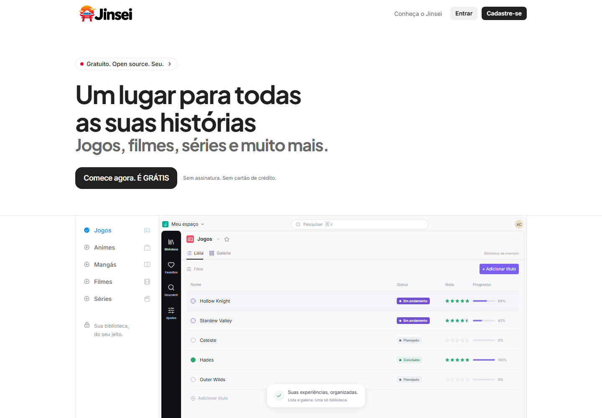
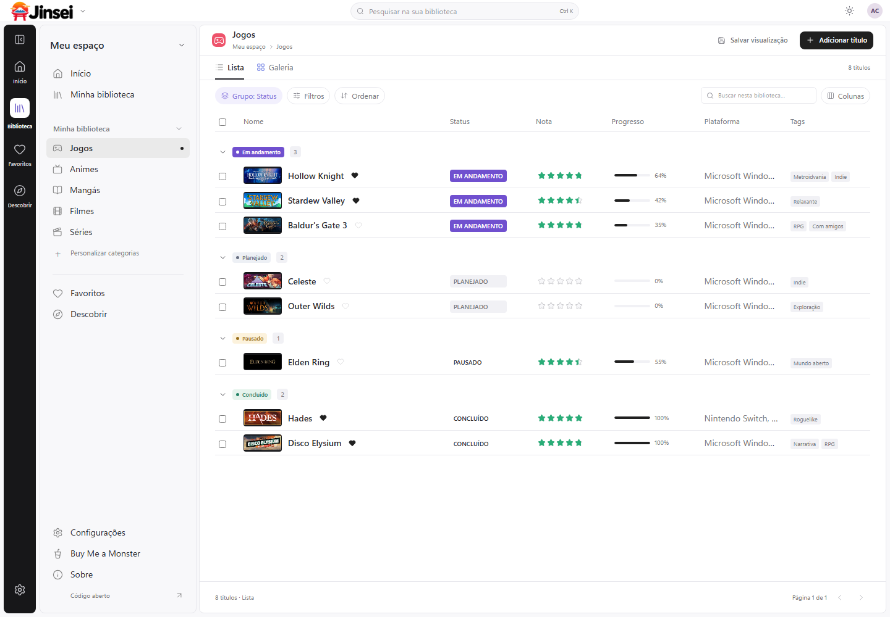
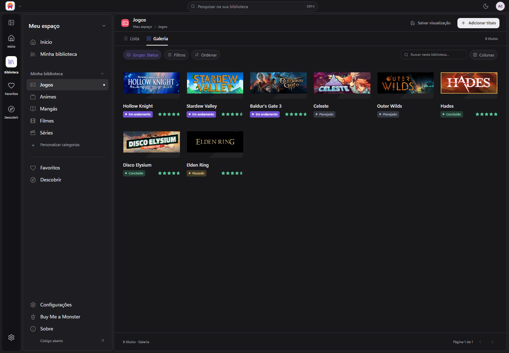

<div align="center">
  
  <h1>Jinsei</h1>
  <p>Sua jornada pelo entretenimento, organizada em um só lugar.</p>
  <p>
    
    
    
    
  </p>
  <p><a href="#funcionalidades">Funcionalidades</a> · <a href="#capturas-de-tela">Capturas</a> · <a href="docs/SELFHOST.md">Self-host</a> · <a href="#instalação">Desenvolvimento</a> · <a href="CONTRIBUTING.md">Contribuir</a> · <a href="SECURITY.md">Segurança</a></p>
</div>

## Sobre o Jinsei

Jinsei é uma aplicação gratuita e open source para organizar jogos, animes, mangás, filmes e séries em uma biblioteca pessoal. Separe o que quer começar, registre suas avaliações e mantenha suas anotações em um espaço privado.

O projeto está em desenvolvimento inicial. A versão **0.0.1** concentra o fluxo completo de Jogos; as demais categorias compartilham cadastro, capas, status, notas e favoritos. Progresso por episódio/capítulo, quadro, calendário, coleções, metas, perfis públicos e uploads ainda não estão disponíveis.

## Funcionalidades

- Cadastro com e-mail e senha, sessão por cookie e onboarding com categorias e tema.
- Biblioteca em Lista e Galeria, agrupamento por status, busca, filtros, ordenação e colunas configuráveis.
- Avaliações em cinco estrelas, com incrementos de ¼ (0,25), favoritos, tags, anotações privadas e edição em lote de status.
- Horas jogadas e percentual de conclusão para jogos.
- Metadados reais e capas com créditos via fontes públicas, além de cadastro pessoal com URL de imagem opcional.
- Temas claro, escuro e sistema, dez cores de destaque, densidade e barra lateral configuráveis.
- Menu da conta com quatro favoritos e perfil privado com estatísticas e até oito destaques.
- Preferências e visualizações persistidas no PostgreSQL.
- Exportação de dados, alteração de senha com revogação de sessões e exclusão de conta.
- Apoio voluntário por Pix quando configurado pelo responsável pela instalação.
- Instalação self-host com Docker e administração da identidade, cadastros e consultas externas da instância.

## Hospede seu próprio servidor

Consulte o [guia de self-host](docs/SELFHOST.md) para instalar as imagens `jinsei-web` e `jinsei-api`, configurar HTTPS, promover sua conta a administrador, fazer backup e atualizar. Não há credenciais padrão. Os pacotes iniciais são Linux amd64 e utilizam PostgreSQL 17 persistente.

As releases seguem `0.0.1` → `0.0.9` → `0.1.0`. As instruções abaixo são para desenvolvimento pelo código-fonte.

## Capturas de tela

Capturas reais da aplicação local, com dados pessoais ilustrativos da conta de demonstração e metadados de catálogos externos.





As imagens das obras pertencem aos respectivos titulares e seguem as condições de suas fontes. Consulte [Integrações e créditos](docs/INTEGRATIONS.md).

## Tecnologias

Monorepo pnpm com Next.js App Router, React, TypeScript, Tailwind CSS, componentes Radix UI, TanStack Query e Table. API NestJS com validação Zod, Prisma e PostgreSQL. Docker Compose fornece PostgreSQL e um serviço S3 local preparado para futuras funcionalidades.

## Instalação

Requisitos: Node.js 24 LTS, pnpm 12.14.0, Docker Engine/Desktop com Compose e acesso à internet para instalar dependências e consultar catálogos.

```sh
git clone https://github.com/caio-kenai/Jinsei.git
cd Jinsei
pnpm install --frozen-lockfile
```

Copie `.env.example` para `.env` (`Copy-Item .env.example .env` no PowerShell, ou `cp .env.example .env` no Linux/macOS). As credenciais do exemplo são exclusivamente locais.

```sh
docker compose up -d --wait --build
pnpm db:generate
pnpm db:migrate
pnpm db:seed
pnpm dev
```

Abra [localhost:3000](http://localhost:3000). API em [localhost:4000/api](http://localhost:4000/api) e documentação OpenAPI em [localhost:4000/api/docs](http://localhost:4000/api/docs).

O seed opcional cria `demo@jinsei.local`, com senha `Jinsei-demo-2026!` (ou `DEMO_PASSWORD` definido antes da primeira execução). Os metadados são consultados em serviços reais; o comando precisa de internet e informa falhas de disponibilidade. Não execute a conta de demonstração em uma instalação pública. O seed recusa `NODE_ENV=production` e não redefine senhas de contas existentes.

O serviço S3 local é compilado de um commit fixo do código oficial do MinIO; a primeira compilação demora mais. Uploads e criação de buckets ainda não fazem parte desta versão.

## Configuração

As fontes públicas funcionam sem chaves. IGDB e TMDB são opcionais e ficam desabilitadas sem configuração; suas condições de uso continuam aplicáveis. Consulte [Integrações](docs/INTEGRATIONS.md) e [.env.example](.env.example). Nunca versionar `.env` ou enviar tokens em issues.

Para uma instalação pública, siga o [guia de self-host](docs/SELFHOST.md) e configure domínio HTTPS, senhas próprias, backups, políticas de retenção e contato do operador. Esta versão não inclui serviço de e-mail, recuperação de senha ou verificação de e-mail. [Aviso de segurança](SECURITY.md).

## Como utilizar

Crie uma conta, escolha suas categorias e abra a biblioteca. Em **Adicionar título**, pesquise no catálogo ou cadastre uma obra pessoal. Abra o título para editar progresso, avaliação, tags e anotações. Troque entre Lista e Galeria; use **Salvar visualização** para guardar filtros, ordenação, agrupamento e colunas. Desabilitar uma categoria a oculta sem apagar seus registros.

Em **Configurações**, personalize seu perfil e a aparência, exporte seus dados ou gerencie sua conta. A biblioteca e as anotações são privadas nesta versão.

## Desenvolvimento e validação

```sh
pnpm typecheck
pnpm lint
pnpm test
pnpm build
pnpm exec playwright install chromium
pnpm test:e2e
```

Os testes de integração precisam do PostgreSQL migrado. As verificações reais dos catálogos e de imagens precisam de internet; não substituem respostas por mocks. As capturas também precisam do seed de demonstração. O Playwright inicia os servidores locais quando necessário.

## Contribuições

Leia [CONTRIBUTING.md](CONTRIBUTING.md) e o [Código de Conduta](CODE_OF_CONDUCT.md). Sugestões e relatos de problemas são bem-vindos; não inclua dados privados da biblioteca ou credenciais.

## Segurança

Consulte [SECURITY.md](SECURITY.md) para limitações da versão inicial e orientações sobre relatos de vulnerabilidades.

## Licença

Código sob [GNU AGPL v3](LICENSE). Fontes, logotipos e imagens de catálogos têm condições próprias, descritas em [THIRD_PARTY_NOTICES.md](THIRD_PARTY_NOTICES.md). A licença do código não transfere direitos sobre as capas.

## Apoie o projeto

O **Buy Me a Monster** oferece apoio voluntário via Pix dentro da aplicação, quando configurado. Ele não libera funcionalidades nem confirma pagamentos. Para habilitar em uma instalação, defina `DONATION_PIX_PAYLOAD` e `DONATION_PIX_KEY` localmente. O QR Code representa o payload exato configurado, com conferência de CRC.
